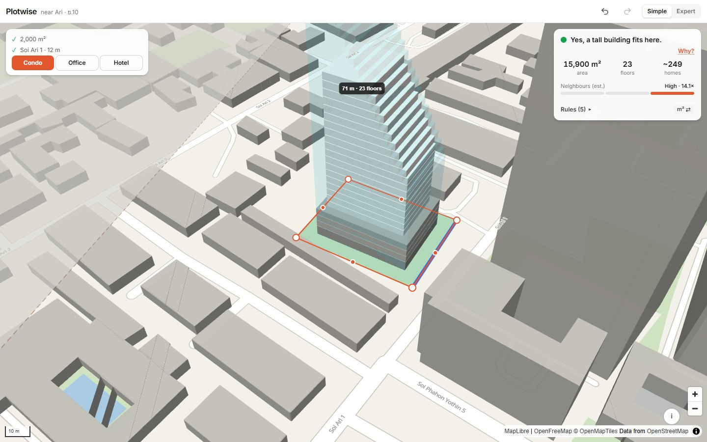
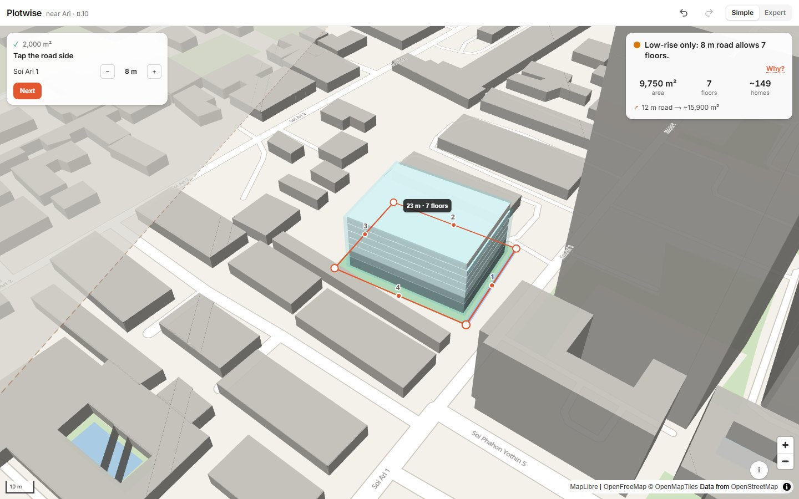
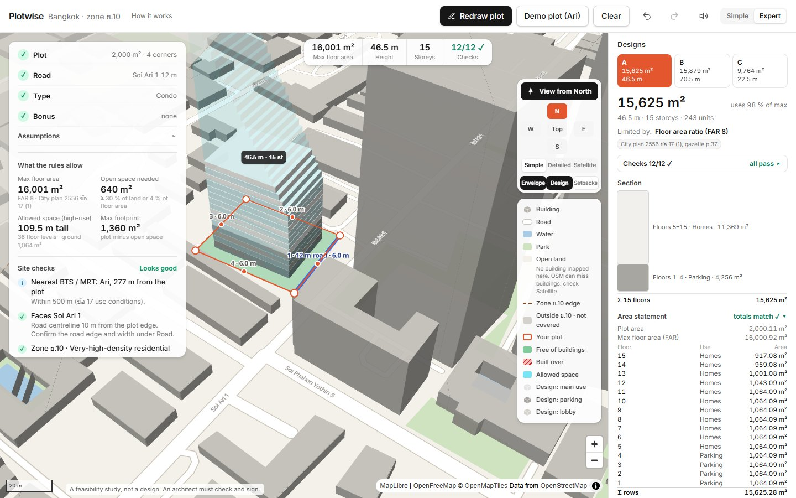

# Plotwise: Bangkok plot feasibility (zone ย.10)

Draw a plot in Bangkok's ย.10 zone, mark the road side, pick a building type, and see live:
- the rules that apply, each with its clause and source;
- the 3D space the law allows (the envelope);
- three designs (terraced block, podium + tower, low-rise), each with a 12-row pass/fail checklist measured independently of the generator;
- the real buildings and roads around the site.

Simple mode explains the result in plain words; Expert mode shows every check, clause and floor.

> A feasibility study, not a design. An architect must check and sign.

## Screenshots
| | |
|---|---|
|  **Simple**: demo plot on a 12 m soi, plain verdict and three numbers |  **8 m road**: high-rise not allowed, low-rise only, and what a wider road would give |
|  **Expert**: 12 checks with clauses; the clicked check (height vs road width) is shown in amber on the model |  **Compare** the three designs |
|  **Area statement**: floor rows, design card and the FAR check's own measurement agree |  **Phone** (390 px) |

## Run locally
```bash
cd app
bun install
bun run dev        # http://localhost:3000/tool?demo=1
bun run test       # vitest (engine, checker, designs)
bun run build && bun run start
```

## Where things are
| Path | What |
|---|---|
| `app/` | Next.js app (TypeScript, Tailwind, MapLibre GL, terra-draw, zustand) |
| `app/src/engine/` | Pure TypeScript engine: geometry, setbacks, envelope, designs, checker |
| `app/src/rules/bangkok-y10.json` | Every rule number used by the engine, with sources |
| `research/RULES.md` | The law for ย.10 in plain English, with clause and page citations |
| `research/AI_MISSES_LOG.md` | Mistakes the AI made during the build and how they were caught |
| `BUILD_PLAN.md`, `EXPECTATIONS.md`, `DEVIATIONS.md` | The spec, the definition of done, and every change from the spec |

## Next (not in v1)
- More than one plot (combine parcels, or compare plots side by side).
- Rule inspector: open any rule with its clause text, the numbers it set on this plot and the checks that use it.
- Zones other than ย.10; Overpass as a second site-context source.

Map data © OpenStreetMap contributors, tiles by OpenFreeMap. Satellite imagery © Esri and partners.
